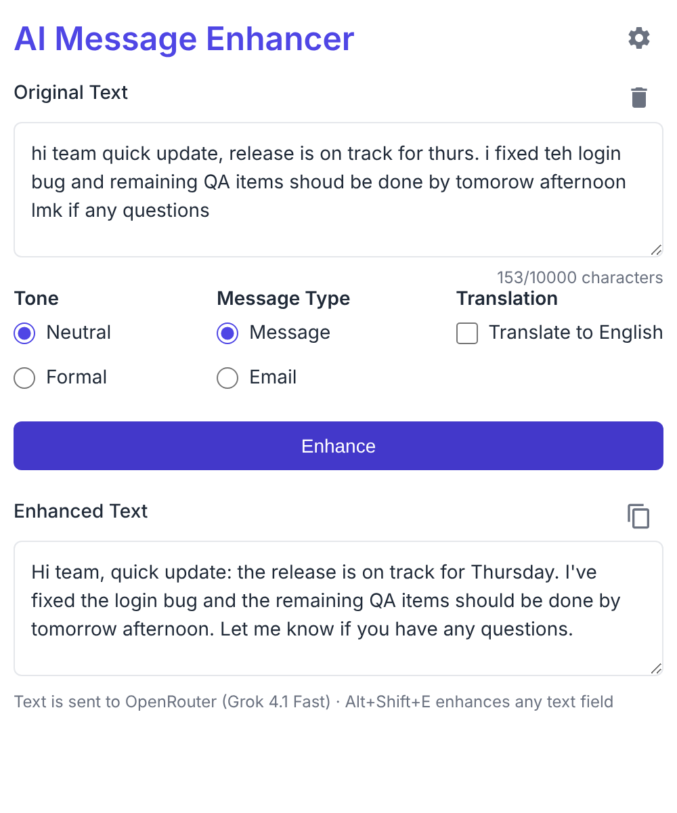
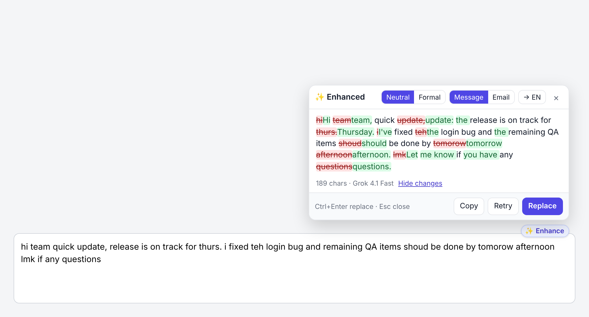
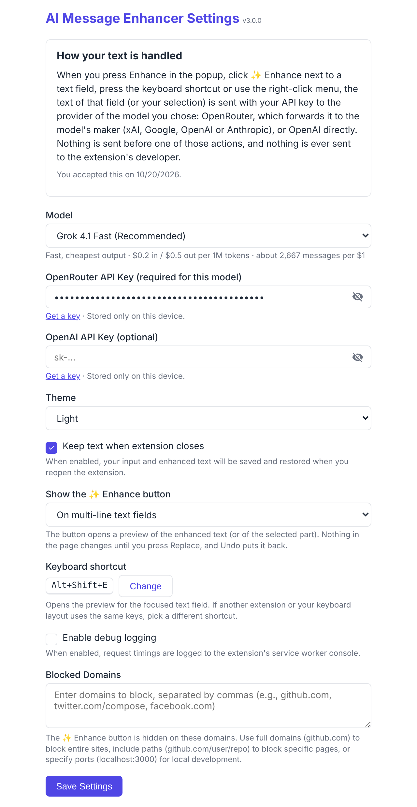

# AI Message Enhancer Chrome Extension

A Chrome extension that enhances, corrects, and beautifies your text using fast, low-cost AI models through OpenRouter (Grok, Gemini, GPT, Claude) or OpenAI directly. Fix typos, improve clarity, adjust tone, and polish your writing for Slack, Teams, email, and any text input across the web.

## Features

### Text Enhancement & Correction
- **Fix typos and spelling errors** automatically
- **Correct grammar and punctuation** mistakes
- **Improve clarity and readability** of your writing
- **Beautify and polish** text while preserving your original meaning
- Bring your own key: OpenRouter (default, Grok 4.1 Fast) or OpenAI
- Responses stream in as they are generated



### Website Integration
- **✨ Enhance button** on message boxes across websites like Teams, Slack, Gmail and Outlook. It sits on the field's border and moves out of the way of the site's own buttons
- **Review before replacing**: the enhanced text streams into a small preview next to the field. Nothing in the page changes until you press **Replace** (or Ctrl+Enter); **Show changes** highlights what was edited
- **Tone, type and translation per site**: Neutral or Formal, Message or Email (Gmail and Outlook start as Email), and translate to English, remembered for each site
- **Selection support**: select part of the text to rewrite only that part and keep @mentions and formatting elsewhere
- **Undo**: one click, or Ctrl+Z, puts the previous text back with its formatting
- **Mail aware**: in Gmail and Outlook, your signature and the quoted thread are never sent or rewritten
- **Keyboard shortcut**: `Alt+Shift+E` opens the preview for the focused field (change it in settings)
- **Right-click menu**: "Enhance with AI Message Enhancer…" on any editable field



### Settings



### Language & Translation
- **Automatic language detection** for any input text
- **Optional translation to English** from the original language
- Preserves original meaning and context during translation
- Works with any input language supported by the selected model

### Message Customization
- Multiple tone options:
  - **Neutral**: Balanced and professional tone (default)
  - **Formal**: Business-appropriate language with complete sentences
- Message type adaptation:
  - **Message**: Optimized for chat messages, social media, and informal communication
  - **Email**: Adds proper email formatting and professional etiquette
- Intelligent tone adjustment when switching between message types

### User Interface & Experience
- Clean, modern interface with intuitive controls
- Dark/Light theme support:
  - System default (automatically follows your browser theme)
  - Light mode for bright environments
  - Dark mode for low-light usage
- Loading indicators with smooth animations for API operations
- Comprehensive error handling with clear, actionable user feedback
- Secure API key input with visibility toggle for easy verification
- Text persistence: Your input text is saved automatically and restored when reopening the extension

## Installation

1. Clone this repository:
   ```bash
   git clone https://github.com/g-guerzoni/chrome-extension-messages-enhancer.git
   cd chrome-extension-messages-enhancer
   ```

2. Load the extension in Chrome (there is no build step):
   - Open Chrome and navigate to `chrome://extensions/`
   - Enable "Developer mode" in the top right corner
   - Click "Load unpacked" and select the extension directory

3. Configure the extension:
   - Click the extension icon in Chrome's toolbar
   - Click the "Settings" button (gear icon)
   - Pick a model and enter the matching API key (OpenRouter or OpenAI)
   - Select your preferred theme
   - Configure website integration settings
   - Click "Save Settings"

## Usage

### Traditional Method (Extension Popup)
1. Click the extension icon in Chrome's toolbar
2. Enter or paste your text (maximum 10000 characters)
3. Configure your enhancement options:
   - Select tone (Neutral or Formal)
   - Choose message type (Message or Email)
   - Enable translation to English if needed
4. Click "Enhance Message" to correct typos, fix grammar, and beautify your text
5. Review the enhanced, polished text in the output area
6. Click the copy icon to copy the corrected text to your clipboard

### Website Integration Method
1. Type your message in a message box (Teams, Slack, Gmail, Outlook or any site)
2. Click **✨ Enhance** on the field's border, press `Alt+Shift+E`, or right-click and choose "Enhance with AI Message Enhancer…"
3. Review the enhanced text in the preview; change the tone, type or translation if you like
4. Press **Replace** (or Ctrl+Enter) to put it in the field, or Esc to close without changes
5. Changed your mind? Click **Undo** next to the button or press Ctrl+Z

## Settings

### API Configuration
- **Model**: choose from a short list of fast, low-cost models (see below)
- **Data notice**: shown on install and on upgrade from v2. Nothing is sent to an AI provider until you press OK
- **API keys**: an OpenRouter key (`sk-or-...`) for the OpenRouter models, or an OpenAI key for the OpenAI models
- API keys and the selected model are stored in Chrome's local storage on this device only (not synced to your Google account)
- Your API key is only sent to the provider of the selected model

### Models

| Model | Provider | Price (input / output per 1M tokens) | Notes |
| --- | --- | --- | --- |
| Grok 4.1 Fast | OpenRouter | $0.20 / $0.50 | Default. Fast, cheapest output, reasoning disabled |
| Gemini 3.1 Flash Lite | OpenRouter | $0.25 / $1.50 | Very low latency |
| GPT-5.4 Nano | OpenRouter | $0.20 / $1.25 | |
| Claude Haiku 4.5 | OpenRouter | $1.00 / $5.00 | Highest quality, higher cost |
| GPT-5 Nano | OpenAI | $0.05 / $0.40 | Minimal reasoning effort |
| GPT-4.1 Nano | OpenAI | $0.10 / $0.40 | |

Prices as listed by the providers when this list was made; check OpenRouter for current prices. Models are configured in `src/config/model.json`.

### User Preferences
- **Theme Selection**: Choose between System, Light, or Dark mode
- **Keep Text on Close**: Automatically save and restore your text between sessions
- **Website Integration**: show the ✨ Enhance button on multi-line fields, only on Slack, Teams, Gmail and Outlook, or never
- **Keyboard shortcut**: see the current shortcut and change it
- **Domain Blocking**: hide the ✨ Enhance button on specific domains or pages (e.g., `github.com`, `twitter.com/compose`)

### Website Integration
- **Where the button shows**: multi-line text fields and rich editors that are big enough; never on search boxes, single-line inputs or tiny fields. The shortcut and the right-click menu work on any text field
- **Rich editors**: text goes in through the editor's own paste handling (Slack, Teams, Lexical-based apps), and the result is checked afterwards. If a site refuses it, the text is copied to the clipboard instead and nothing in the field changes
- **Performance optimized**: no page polling; the script reacts when a text field gets focus and only tracks the field while the button is visible
- Password, one-time-code, card and similar fields are ignored, as are sites whose host looks like banking or login pages

## Platform Support

The extension works seamlessly across multiple platforms:

### Supported Websites
- **Microsoft Teams**: Message composition and reply inputs
- **Slack**: Channel messages and direct message inputs
- **Gmail**: Email composition and reply areas
- **Generic Support**: Standard HTML text inputs, textareas, and contenteditable elements on any website

### Browser Compatibility
- Google Chrome (Manifest V3)
- Chromium-based browsers (Edge, Brave, etc.)

## Development

The extension is built with vanilla JavaScript and follows a clean, modular architecture:

### Project Structure
```
├── manifest.json              # Extension configuration and permissions
├── src/
│   ├── config/                # Providers, models, prompt instructions and limits
│   ├── interface/
│   │   ├── popup.html         # Main extension interface
│   │   └── options.html       # Settings page
│   ├── scripts/
│   │   ├── popup.js           # Main UI logic and enhancement handling
│   │   ├── options.js         # Settings management
│   │   ├── background.js      # Service worker: streaming API calls, shortcut, context menu
│   │   ├── content.js         # Website integration script (in-place enhancement)
│   │   └── shared.js          # Config/settings helpers shared by the extension pages
│   └── styles/
│       ├── common.css         # Shared styles and theme variables
│       ├── popup.css          # Main interface styles
│       └── options.css        # Settings page styles
├── icons/                     # icon16/32/48/128.png; icon.svg and icon16.svg are their sources
└── docs/screenshots/          # README images (not packaged)
```

### Key Technical Features
- **Manifest V3**: Uses the latest Chrome extension architecture
- **Service Worker**: Background script handles API communication efficiently
- **Content Script Injection**: Safely adds enhancement icons to websites
- **Chrome Storage API**: Secure storage for user preferences and API keys
- **Error Handling**: Comprehensive error management with user-friendly messages
- **Performance Optimized**: Minimal impact on website loading and browser performance

### Debugging
- **Background script logs**: Access via Chrome's extension developer tools
  - Go to `chrome://extensions/`
  - Find AI Message Enhancer
  - Click "Service Worker" under "Inspect views"
- **Popup logs**: Right-click the extension popup and select "Inspect"
- **Content script logs**: Open browser DevTools on any website and check the Console tab

## Requirements

- Google Chrome browser (version 88+)
- An OpenRouter API key (or an OpenAI API key)

## Version History

### v3.0.0 (Current)
- Added OpenRouter support with a short list of fast, low-cost models; Grok 4.1 Fast is the new default
- Responses stream into the popup as they are generated; reasoning is disabled or minimal for faster answers
- New in-page flow: a ✨ Enhance button that avoids the site's own buttons and opens a streaming preview with tone, type and translation per site, a word diff, Replace, Copy, Retry and Undo. Nothing changes in the page until you press Replace
- Added a keyboard shortcut (`Alt+Shift+E`) and a right-click menu entry, and a settings choice for where the button shows
- Text goes in through each editor's own paste handling and is verified, so Slack (Quill), Teams (CKEditor 5) and Lexical-based editors work and Ctrl+Z undoes it; Gmail and Outlook signatures and quoted threads are left alone
- A data notice must be accepted before any text is sent, as the Chrome Web Store requires
- API keys and saved text moved from sync storage to local storage (existing settings are migrated automatically)
- Clearer API errors, including empty or truncated responses
- Content script rewritten: no polling, works in iframes and modal dialogs, skips search, sensitive, disabled and read-only fields
- Popup fits in one screen, guides first-run key setup and keeps errors readable; settings mark which key the model needs
- New toolbar icon, local SVG icons instead of Google Fonts, and the icon PNGs are committed so fresh clones load

### v2.4.2
- Added version display in settings page header
- Improved content script input validation to exclude more input types (radio, checkbox, file, etc.)
- Enhanced input type filtering to support search, url, and tel inputs

### v2.1.0
- Added domain blocking feature to disable enhancement icons on specific websites
- Fixed content script initialization timing issues
- Fixed missing CSS styles for textarea and checkbox labels in options page
- Improved domain validation and Chrome storage sync integration
- Added debug logging for troubleshooting

### v2.0.0
- Enhancement text icon (✨) now appear directly in text inputs across websites like Teams, Slack, Gmail and others
- Enhanced text input detection with floating icons
- Support for major platforms (Gmail, Slack, Teams, etc.)
- Theme management and settings persistence
- Content script with website integration capabilities

### v1.1.0
- Updated to GPT-4.1 Nano model
- Improved text persistence features
- Enhanced user interface

### v1.0.0
- Initial release with core message enhancement features
- Theme support and basic UI

## Author

Guilherme Guerzoni

## License

MIT License - See LICENSE file for details
